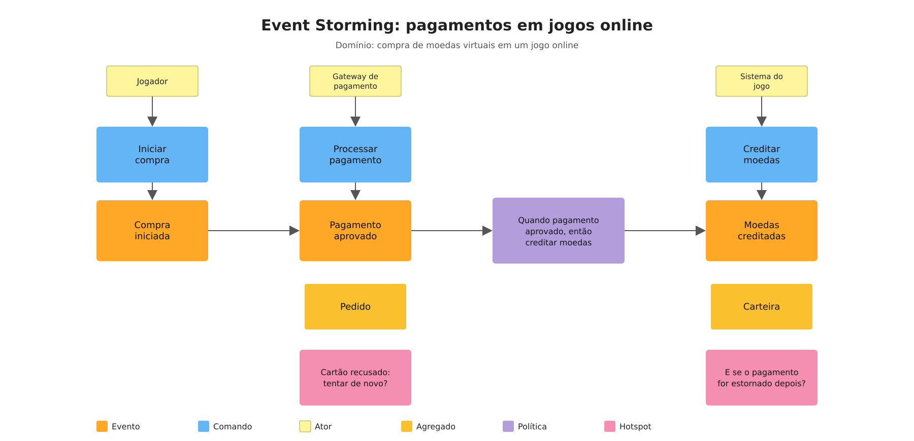

# ATIVIDADE - AULA 7

## Domínio: pagamentos em jogos online

**Tema escolhido:** compra de moedas virtuais em um jogo online.

### Eventos (linha do tempo)

1. **Compra iniciada:** o jogador começou a compra de moedas.
2. **Pagamento aprovado:** o gateway de pagamento aprovou o valor cobrado.
3. **Moedas creditadas:** o saldo de moedas foi atualizado na carteira do jogador.

### Comandos

- **Iniciar compra**, disparado pelo jogador.
- **Processar pagamento**, disparado pelo gateway de pagamento.
- **Creditar moedas**, disparado pelo sistema do jogo.

### Atores

- Jogador
- Gateway de pagamento
- Sistema do jogo

### Agregados

- **Pedido:** registra a compra e aplica a regra de processamento do pagamento.
- **Carteira:** guarda o saldo de moedas do jogador.

### Política

- **Quando o pagamento for aprovado, então creditar moedas.** Regra automática, sem intervenção humana.

### Hotspots

- **Cartão recusado:** o jogador pode tentar de novo?
- **Estorno depois do crédito:** o que acontece se o pagamento for estornado depois que as moedas já foram creditadas?
