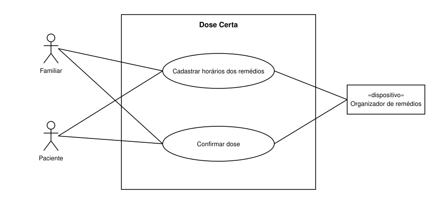
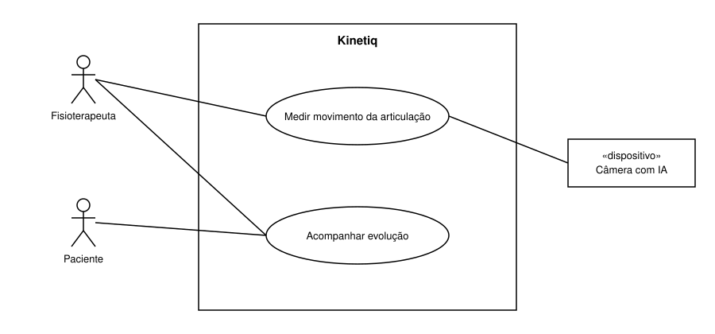

# ATIVIDADE - REQUISITOS IDEATHON

## INOVA SAÚDE 2026

Das dez apresentações finalistas do Demoday de 05/11, escolhi duas: **Dose Certa** (1º lugar) e **Kinetiq** (2º lugar). Para cada uma, mapeei dois casos de uso e, a partir de cada caso de uso, escrevi uma história de usuário com três critérios de aceitação.

**Arquivos:** os diagramas foram feitos no diagrams.net (`dose_certa.drawio` e `kinetiq.drawio`) e exportados como imagem (`dose_certa.svg` e `kinetiq.svg`).

---

## 1. Dose Certa

**Equipe:** Dose Certa (Odontologia). 1º lugar.

**O problema:** quem toma vários remédios por dia esquece doses, confunde horários e interrompe o tratamento.

**A ideia:** um organizador de remédios ligado a um aplicativo, que avisa a hora da dose, acende a luz do compartimento certo e alerta o familiar quando o paciente não confirma.

### Diagrama de casos de uso

- **Fronteira:** Dose Certa.
- **Atores principais:** Familiar e Paciente.
- **Ator secundário:** «dispositivo» Organizador de remédios.
- **Casos de uso:**
  - **Cadastrar horários dos remédios:** o familiar ou o paciente informa cada remédio, o compartimento do organizador e os horários das doses. O organizador recebe a programação.
  - **Confirmar dose:** na hora da dose, o organizador acende o compartimento certo e o paciente confirma que tomou. Se ele não confirma, o familiar recebe um alerta.

### Caso de uso 1: Cadastrar horários dos remédios

**História de usuário.** Como familiar de um paciente que toma vários remédios, quero cadastrar no aplicativo os horários de cada remédio, para que o organizador avise o paciente na hora certa de cada dose.

**Critérios de aceitação**

1. **Dado que** informei o remédio, o compartimento e os horários das doses, **quando** salvo o cadastro, **então** os horários aparecem na agenda do dia e o organizador é programado.
2. **Dado que** deixei o horário da dose em branco, **quando** tento salvar, **então** o aplicativo avisa que o horário é obrigatório e não salva o cadastro.
3. **Dado que** o organizador está desconectado do celular, **quando** salvo o cadastro, **então** o aplicativo guarda os horários e avisa que vai enviá-los ao organizador assim que ele se conectar.

### Caso de uso 2: Confirmar dose

**História de usuário.** Como paciente que toma vários remédios por dia, quero ser avisado na hora da dose e saber qual compartimento abrir, para não esquecer nem confundir os remédios.

**Critérios de aceitação**

1. **Dado que** chegou o horário de uma dose, **quando** o alarme toca, **então** a luz do compartimento certo acende e o aplicativo mostra o nome do remédio.
2. **Dado que** tomei o remédio, **quando** confirmo a dose no aplicativo, **então** a dose fica registrada como tomada e a luz do compartimento apaga.
3. **Dado que** não confirmei a dose em até 30 minutos, **quando** esse prazo termina, **então** o meu familiar recebe um alerta no celular com o nome do remédio e o horário.

---

## 2. Kinetiq

**Equipe:** KineTiq (Ciência da Computação, Engenharia Civil e Engenharia de Software). 2º lugar.

**O problema:** na reabilitação, a medida do movimento feita à mão muda conforme quem mede, e o paciente não vê o próprio progresso.

**A ideia:** uma câmera com IA mede os ângulos das articulações, salva a sessão e compara com as anteriores num gráfico.

### Diagrama de casos de uso

- **Fronteira:** Kinetiq.
- **Atores principais:** Fisioterapeuta e Paciente.
- **Ator secundário:** «dispositivo» Câmera com IA.
- **Casos de uso:**
  - **Medir movimento da articulação:** o fisioterapeuta escolhe a articulação, a câmera com IA mede os ângulos durante o exercício e a sessão é salva.
  - **Acompanhar evolução:** o fisioterapeuta e o paciente veem num gráfico os ângulos de cada sessão, comparados com as anteriores.

### Caso de uso 1: Medir movimento da articulação

**História de usuário.** Como fisioterapeuta, quero que a câmera meça o ângulo da articulação durante o exercício, para ter uma medida que não mude conforme quem mede.

**Critérios de aceitação**

1. **Dado que** o paciente está posicionado na frente da câmera, **quando** inicio a medição do joelho, **então** o sistema mostra o ângulo em tempo real e o maior ângulo alcançado.
2. **Dado que** a articulação não aparece inteira na imagem, **quando** inicio a medição, **então** o sistema pede para reposicionar o paciente e não registra a medida.
3. **Dado que** terminei a medição, **quando** salvo a sessão, **então** ela fica no histórico do paciente com a data, a articulação e os ângulos medidos.

### Caso de uso 2: Acompanhar evolução

**História de usuário.** Como paciente em reabilitação, quero ver num gráfico a evolução do meu movimento, para perceber o meu progresso e continuar motivado com o tratamento.

**Critérios de aceitação**

1. **Dado que** tenho duas ou mais sessões salvas, **quando** abro a minha evolução, **então** vejo um gráfico com o maior ângulo de cada sessão, em ordem de data.
2. **Dado que** tenho só uma sessão salva, **quando** abro a minha evolução, **então** o sistema mostra o ângulo dessa sessão e avisa que o gráfico aparece a partir da segunda.
3. **Dado que** o fisioterapeuta definiu uma meta de ângulo, **quando** abro a minha evolução, **então** o gráfico mostra a linha da meta e quantos graus faltam para alcançá-la.
